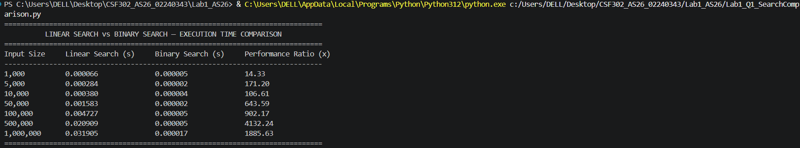
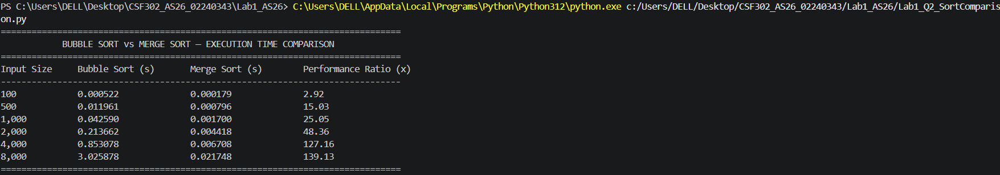
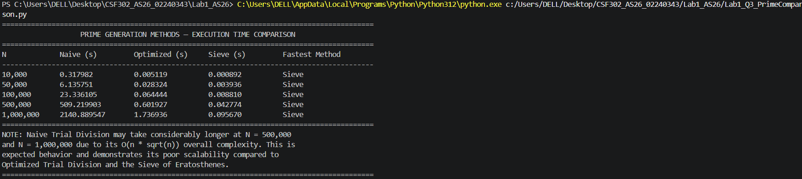

# Lab: Empirical Growth Rate Measurement and Algorithm Benchmarking


## Question 1: 
- Implement Linear Search.
- Implement Binary Search.
- Generate random datasets of different sizes.
- Sort the dataset before applying Binary Search.
- Measure the average execution time for both algorithms.

Input Sizes:

```
1,000
5,000
10,000
50,000
100,000
500,000
1,000,000
```
Output:



## Question 2

- Implement Bubble Sort.
- Implement Merge Sort.
- Generate random arrays.
- Measure average execution time.

Input Sizes: 

```
100
500
1000
2000
4000
8000
```
Output:



## Question 3:
- Compare different methods of generating prime numbers and analyze their empirical performance.

- Tasks
   - Implement the following algorithms:
   - Naive Prime Checking using Trial Division
   - Optimized Trial Division (checking up to √n)
   - Sieve of Eratosthenes
   - Measure the execution time required to generate all prime numbers up to N.

Input Sizes:

```
10,000
50,000
100,000
500,000
1,000,000
```
Output:

