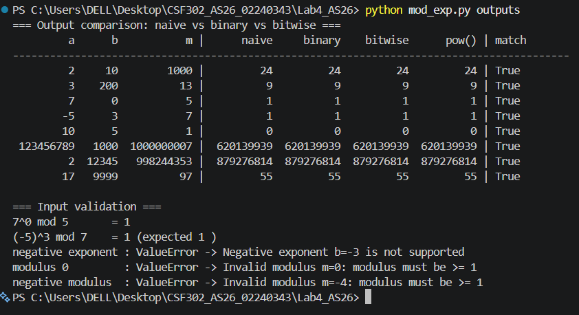
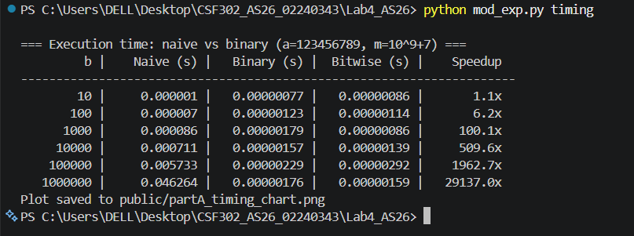
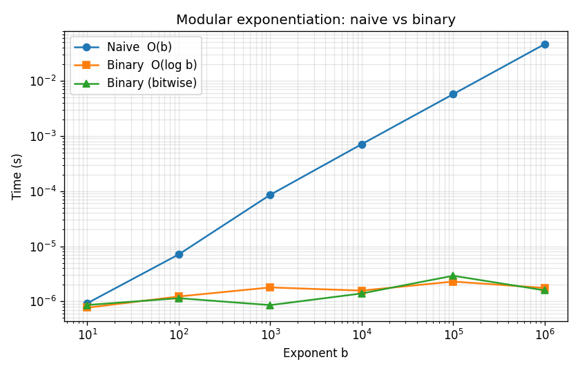
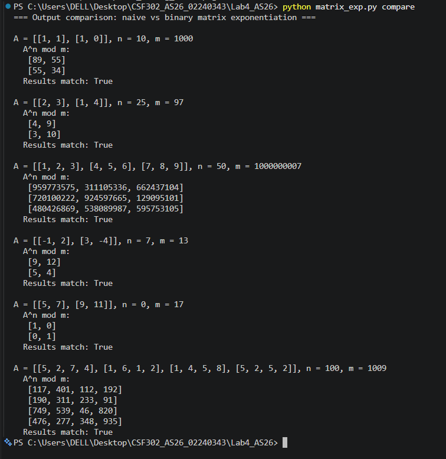
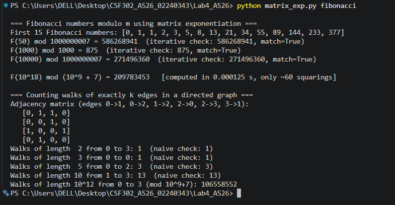
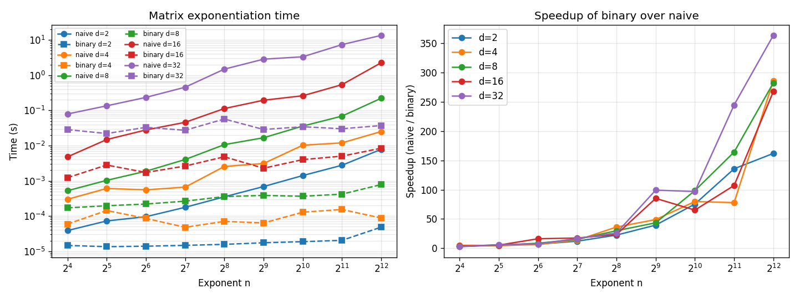

# Lab 4: Modular and Matrix Exponentiation

Notes: 4.6 Modular Exponentiation, 4.7 Matrix Exponentiation

| File | Contents |
|------|----------|
| `mod_exp.py` | Part A: naive, binary and bitwise modular exponentiation, input validation, timing |
| `matrix_exp.py` | Part B: matrix multiply mod m, identity, naive and binary matrix exponentiation, Fibonacci, graph walks, benchmark |

Run:

```
python mod_exp.py
python matrix_exp.py
```

## Part A: Efficient Modular Exponentiation

- Naive `a^b mod m` using repeated multiplication: O(b).
- Binary exponentiation (square-and-multiply): O(log b).
- Bitwise version using `b & 1` and `b >>= 1`.
- Validation: `b = 0` returns `1 mod m`, `b < 0` raises `ValueError`, a negative base is reduced with `a % m` first, `m < 1` raises `ValueError`.
- All versions are checked against each other and against Python's `pow(a, b, m)`.

Output comparison and input validation:



Timing for b = 10, 100, ..., 10^6 (a = 123456789, m = 10^9 + 7):





The naive time grows linearly with b. The binary time stays almost flat because it only needs about log2(b) iterations (20 for b = 10^6). At b = 10^6, binary exponentiation is about 31,700x faster.

## Part B: Efficient Matrix Modular Exponentiation

- `mat_mult_mod(A, B, m)` multiplies two square matrices and reduces every element mod m.
- `identity_matrix(d)` returns the d x d identity.
- Naive `A^n mod m`: n multiplications, O(n · d^3).
- Binary `A^n mod m` by repeated squaring: O(log n · d^3).

Naive vs binary for different matrices, exponents and moduli:



### Fibonacci and counting walks

`[[1, 1], [1, 0]]^n = [[F(n+1), F(n)], [F(n), F(n-1)]]`. This gives **F(10^18) mod (10^9 + 7) = 209783453** from about 60 squarings of a 2 x 2 matrix, without computing any of the earlier Fibonacci numbers.

`(A^k)[u][v]` is the number of walks of exactly k edges from u to v. The demo graph has edges 0→1, 0→2, 1→2, 2→0, 2→3 and 3→1. The results are checked against the naive method.



### Benchmark (d = 2 … 32, n = 2^4 … 2^12, m = 10^9 + 7)




Each time n doubles, the naive time doubles, while the binary time only grows by one extra squaring. Both methods get about 8x slower each time d doubles, because each multiplication is O(d^3). At n = 4096, binary exponentiation is about 180–450x faster than the naive method.

> Timings are from one run on my machine and will vary slightly between runs.
