# Lab 5: Sorting Algorithms

Notes: 5.3 Quicksort, 5.4 Randomised Quicksort, 5.5 Counting Sort, 5.6 Radix Sort, 5.7 Counting Inversions

| File | Contents |
|------|----------|
| `quicksort_variants.py` | Q1: Lomuto, Hoare, randomised and three-way quicksort, comparison counts and timing |
| `linear_sorts.py` | Q2: stable counting sort, LSD radix sort (base 10 and 256), comparison with Lab 1 merge sort, plots |
| `inversions.py` | Q3: brute-force and merge-sort inversion counting, timing, Kendall tau distance |

## Q1: Quicksort Variants

- Lomuto partition with the last element as pivot.
- Hoare partition with the first element as pivot.
- Randomised quicksort: a random pivot is swapped to the end, then Lomuto partition is used.
- Three-way (Dutch national flag) quicksort with a random pivot.
- Every variant recurses on the smaller part and loops on the larger part, so the recursion depth stays O(log n) even on sorted input.

```
python quicksort_variants.py check
python quicksort_variants.py random
python quicksort_variants.py sorted
python quicksort_variants.py reverse
python quicksort_variants.py duplicates
```

Correctness check:

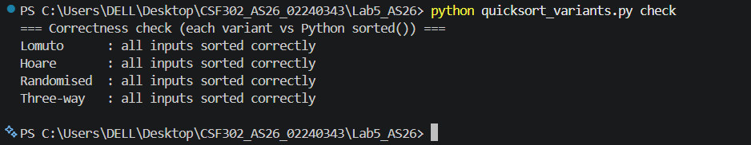

Random input:

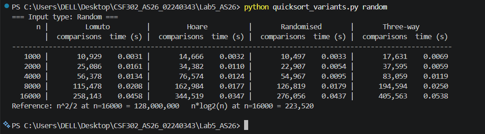

Already sorted input:

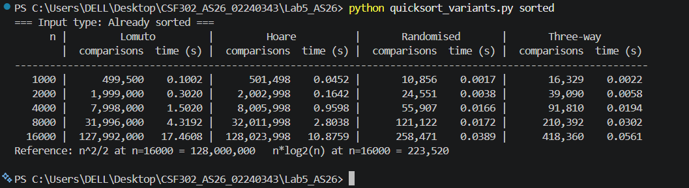

Reverse sorted input:

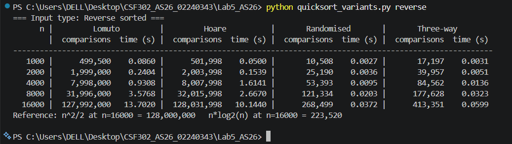

Many duplicates (values 0 to 9):

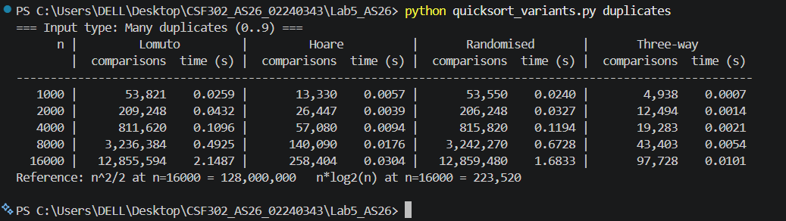

### Which variant degrades to Θ(n²), and why

| Variant | Random | Sorted | Reverse | Many duplicates |
|---------|--------|--------|---------|-----------------|
| Lomuto (last pivot) | n log n | **n²** | **n²** | **n²** |
| Hoare (first pivot) | n log n | **n²** | **n²** | n log n |
| Randomised (Lomuto) | n log n | n log n | n log n | **n²** |
| Three-way | n log n | n log n | n log n | fastest |

- **Lomuto and Hoare on sorted and reverse sorted input:** the first or last element is always the smallest or largest value, so each partition removes only the pivot. That gives n(n−1)/2 comparisons, about 128 million at n = 16,000.
- **Lomuto on many duplicates:** elements equal to the pivot all go to the same side (`arr[j] <= pivot`). A run of equal values is therefore peeled off one element at a time.
- **Randomised quicksort:** a random pivot fixes the sorted and reverse cases. It still uses Lomuto, though, so it degrades on duplicates in the same way. A random pivot can't help when most elements equal it.
- **Hoare on many duplicates:** both scans stop at elements equal to the pivot and swap them, which splits runs of equal values in the middle, so it stays fast.
- **Three-way on many duplicates:** it puts everything equal to the pivot in the middle and never touches those elements again. With only 10 distinct values it needs very few levels, so it is the fastest variant on this input.

## Q2: Counting Sort and Radix Sort

- Stable counting sort for integers in the range 0 to k: O(n + k).
- LSD radix sort using counting sort on each digit, in base 10 and base 256: O(d(n + b)).
- Both are compared with `MergeSort_343` from Lab 1 (copied into `merge_sort.py`).

```
python linear_sorts.py stable
python linear_sorts.py counting
python linear_sorts.py radix
```

Stability: sorting (key, original index) pairs keeps equal keys in their original index order.

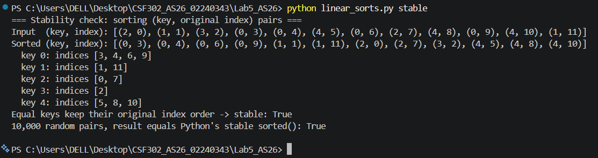

Counting sort, n = 100,000, k = 10 to 10^7:

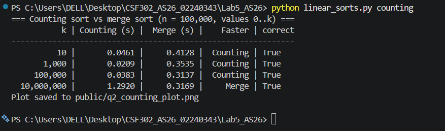

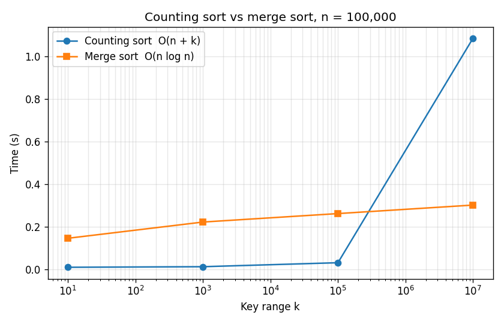

Radix sort, k = 10^9, n = 10,000 to 1,000,000:

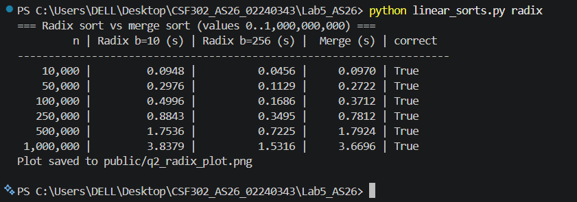

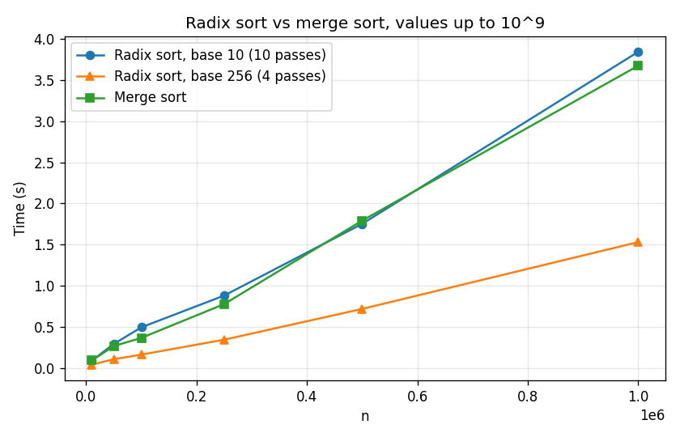

**When the linear-time sorts win:**
- Counting sort wins while k is small compared to n (k ≤ 10^5 here).
- Radix sort in base 256 wins because values up to 10^9 need only 4 passes.

**When they lose:**
- Counting sort loses when k is much larger than n (k = 10^7). The O(k) count array then costs more than merge sort's O(n log n).
- Radix sort in base 10 needs 10 passes, which costs about as much as merge sort's ~20 merge levels, so it is roughly tied with merge sort.

## Q3: Counting Inversions

- Brute force: check every pair, O(n²).
- Merge-sort-based: when an element from the right half is merged before `left[i]`, it forms `len(left) - i` inversions at once, O(n log n).

```
python inversions.py verify
python inversions.py timing
python inversions.py kendall
```

Verification on random arrays of size up to 2,000:

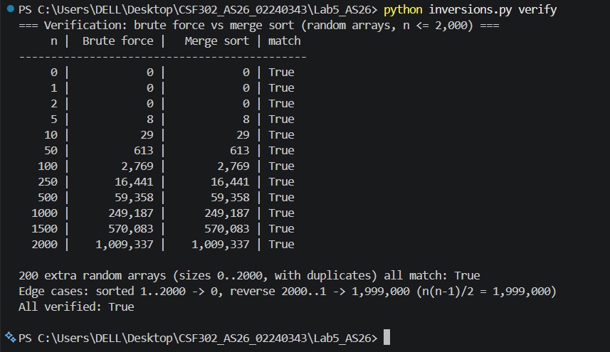

Timing for n = 1,000 to 1,000,000. Brute force is stopped once a run passes 60 seconds:

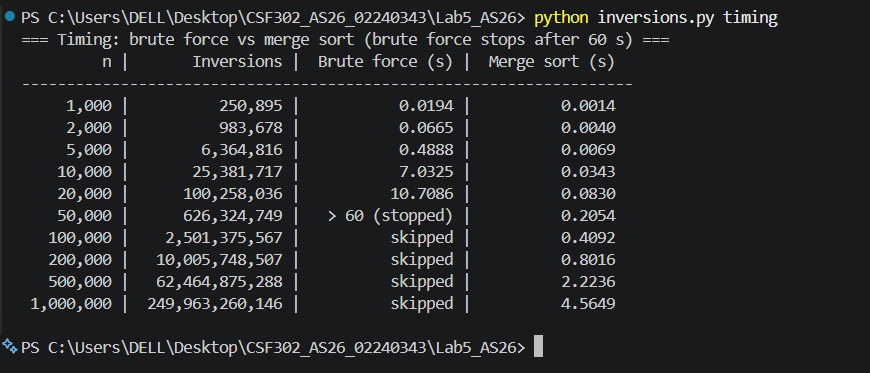

Kendall tau distance between two users' rankings of 10 movies. User 2's ranking is rewritten in terms of user 1's positions, and the inversion count is the number of movie pairs the two users order differently (0 = identical, 45 = completely reversed).

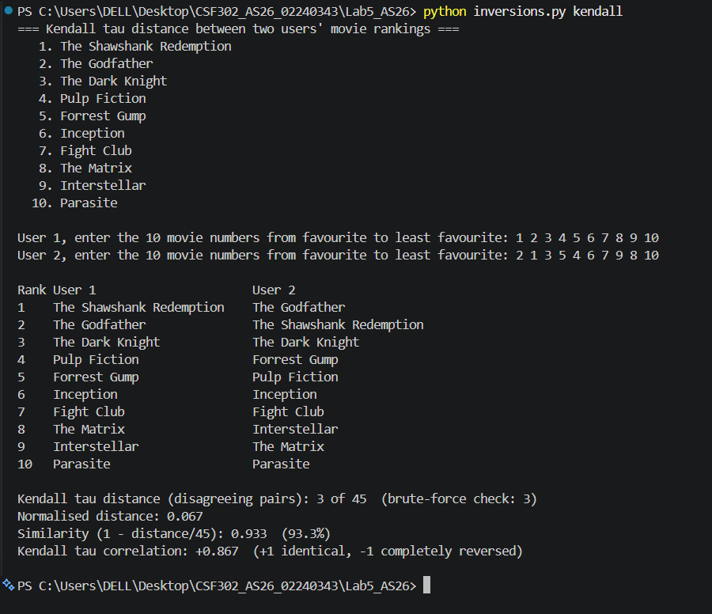

> Timings are from one run on my machine and will vary slightly between runs.
