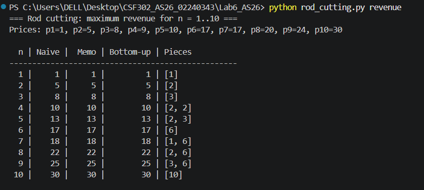
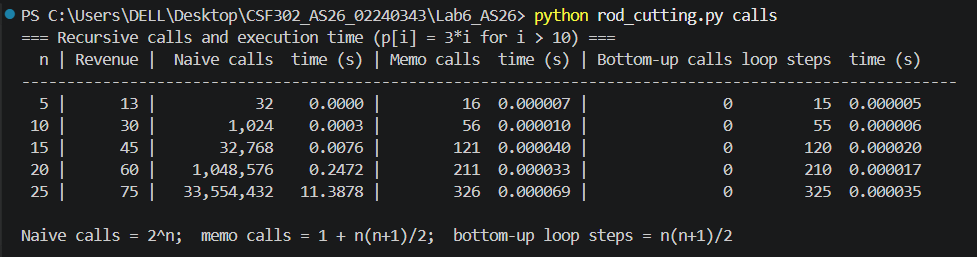
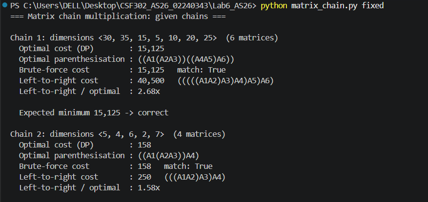
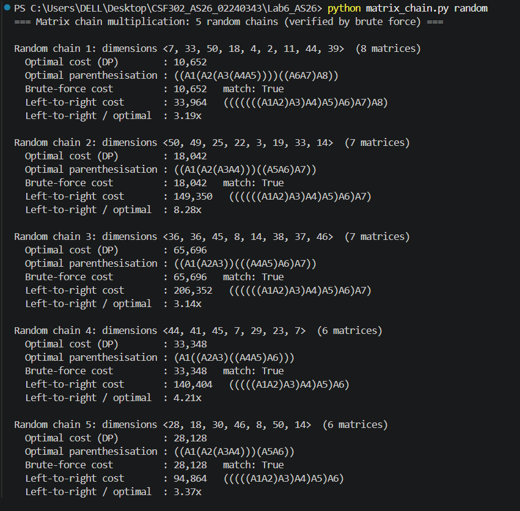
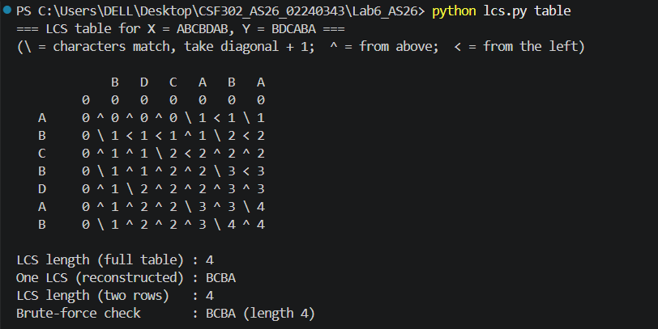
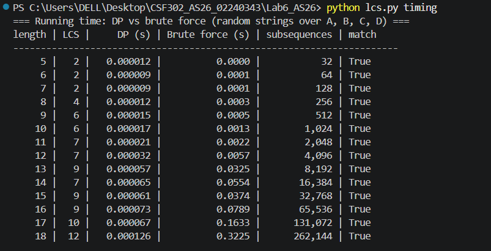
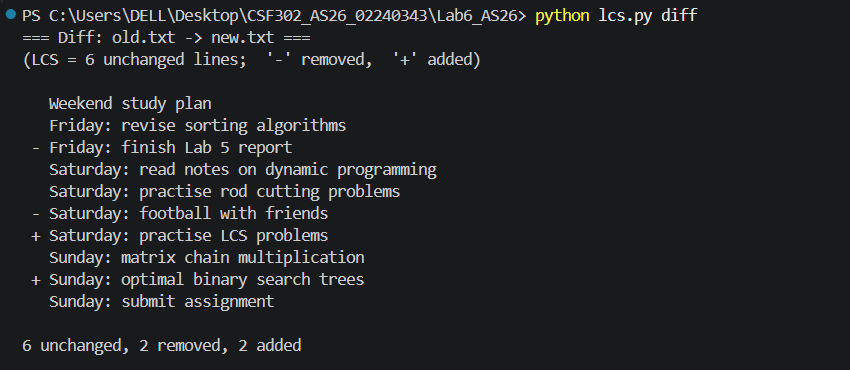
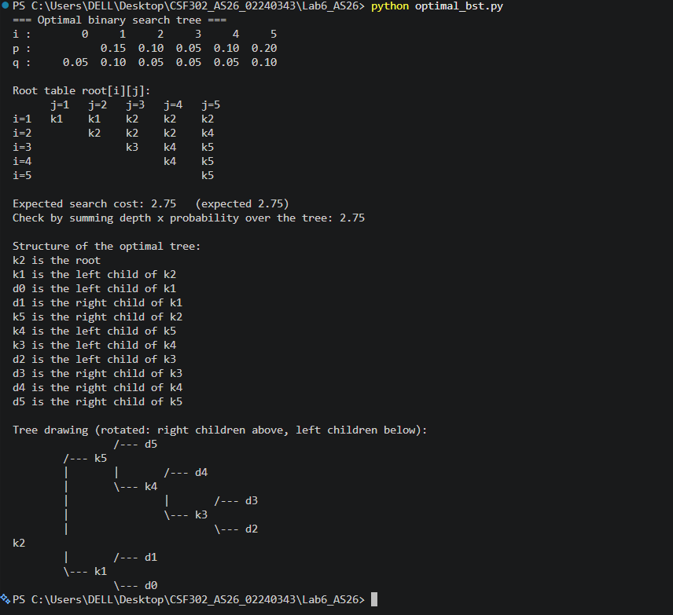

# Lab 6: Dynamic Programming

Notes: 6.1 DP Principles, 6.2 Rod Cutting, 6.3 Matrix Chain, 6.4 LCS, 6.5 Optimal BST

| File | Contents |
|------|----------|
| `rod_cutting.py` | Q1: naive, memoized and bottom-up rod cutting, call counts and timing |
| `matrix_chain.py` | Q2: bottom-up matrix chain DP, parenthesisation, brute-force check, left-to-right cost |
| `lcs.py` | Q3: LCS table, reconstruction, two-row length, brute-force timing, line diff |
| `old.txt`, `new.txt` | Two short text files used for the diff |
| `optimal_bst.py` | Q4 (optional): optimal binary search tree |

## Q1: Rod Cutting

Prices for lengths 1 to 10: 1, 5, 8, 9, 10, 17, 17, 20, 24, 30. For lengths over 10, p[i] = 3i.

```
python rod_cutting.py revenue
python rod_cutting.py calls
```

Maximum revenue and piece lengths for n = 1 to 10:



Recursive calls and execution time for n = 5, 10, 15, 20, 25:



| Version | Calls | Complexity |
|---------|-------|------------|
| Naive recursive | 2^n (33,554,432 for n = 25) | Θ(2^n) |
| Top-down memoized | 1 + n(n+1)/2 (326 for n = 25) | Θ(n²) |
| Bottom-up tabulated | 0 recursive calls, n(n+1)/2 loop steps | Θ(n²) |

**Why the counts differ:**
- **Naive:** the naive version solves the same subproblems over and over. A rod of length n calls every shorter length, so T(n) = 1 + T(0) + … + T(n−1) = 2^n.
- **Memoized:** memoization stores each answer the first time it is computed, so every repeated call becomes a table lookup.
- **Bottom-up:** bottom-up does the same Θ(n²) work in a loop with no recursion at all, so it is the fastest.

## Q2: Matrix Chain Multiplication

```
python matrix_chain.py fixed
python matrix_chain.py random
```

The two given chains: <30, 35, 15, 5, 10, 20, 25> gives the expected minimum of 15,125, and <5, 4, 6, 2, 7> gives 158.



Five random chains of 4 to 8 matrices, each checked against a brute-force recursive search:



The left-to-right order costs between 1.6x and 8x more than the optimal order for these chains.

## Q3: Longest Common Subsequence

```
python lcs.py table
python lcs.py timing
python lcs.py diff
```

LCS table for X = ABCBDAB and Y = BDCABA. In the table, `\` means the characters match, `^` means the value comes from above, and `<` means it comes from the left. The reconstructed LCS is BCBA (length 4). The two-row version gives the same length using only O(min(m, n)) space.



DP compared with brute force (every subsequence of X) for string lengths 5 to 18:



The brute-force time doubles with each extra character (2^m subsequences). The DP is O(mn) and stays under a millisecond.

Line-by-line diff of `old.txt` and `new.txt`. Lines in the LCS are unchanged, `-` lines were removed and `+` lines were added:



## Q4 (Optional): Optimal Binary Search Tree

```
python optimal_bst.py
```

The expected search cost is 2.75. The optimal tree has k2 at the root, k1 on the left and k5 on the right, then k4 under k5 and k3 under k4.



The most likely key, k5, is not at the root, so choosing the most frequent key first (greedy) would not give the optimal tree.

> Timings are from one run on my machine and will vary slightly between runs.
