# Lab 7: Greedy and Randomized Algorithms

Notes: 7.2 Fractional Knapsack, 7.3 Huffman Coding, 7.4 Activity Selection, 7.5 Dijkstra, 7.6 MST, 7.7 Randomized Algorithms

| File | Contents |
|------|----------|
| `greedy.py` | Q1: activity selection (3 greedy rules), fractional knapsack, greedy vs DP on 0/1 knapsack |
| `huffman.py` | Q2: Huffman tree with `heapq`, code table, encode/decode, compression ratio |
| `graphs.py` | Q3: Dijkstra (binary heap), Kruskal (union-find), Prim (heap), timing, negative edge |
| `randomized.py` | Q4: randomized quickselect, Miller–Rabin, Carmichael number 561 |
| `data/activities.txt` | Activities as `start finish` pairs |
| `data/english_text.txt`, `data/python_code.txt`, `data/dna_sequence.txt` | The three text files for Huffman coding |
| `data/graph.txt` | Weighted directed graph as `from to weight` lines |

## Q1: Activity Selection and Knapsack

```
python greedy.py select
python greedy.py counter
python greedy.py fractional
python greedy.py knapsack01
```

Earliest-finish activity selection on the activities in `data/activities.txt`:

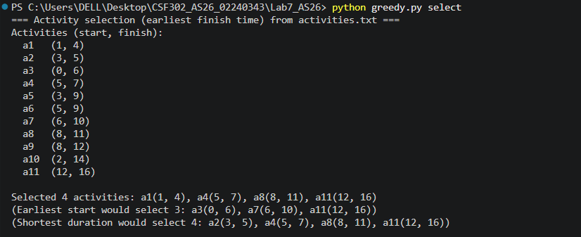

Random testing finds a small input where each of the other two rules (earliest start, shortest duration) selects fewer activities than earliest finish:

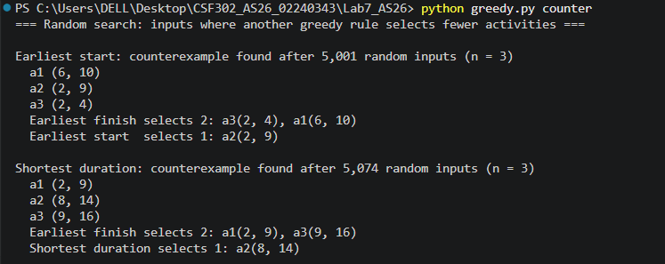

- **Earliest start** loses when one long activity starts first and blocks shorter ones.
- **Shortest duration** loses when a short activity overlaps two others that would both fit.

Fractional knapsack, taking items by highest value/weight ratio:

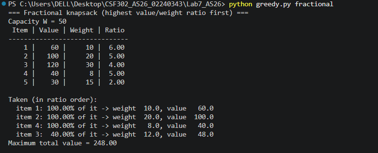

The same greedy rule applied to 0/1 knapsack, compared with the DP on 5,000 random inputs:

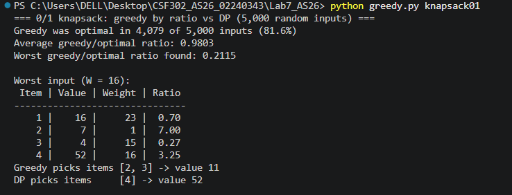

Greedy was optimal in about 82% of the inputs. The worst ratio found was **0.21**: greedy takes a light item with a high ratio, and the most valuable item no longer fits. No fixed ratio can be guaranteed, because the greedy result can be made arbitrarily bad.

## Q2: Huffman Coding

```
python huffman.py table
python huffman.py compare
```

Code table for `english_text.txt`, with encoding and decoding checked:

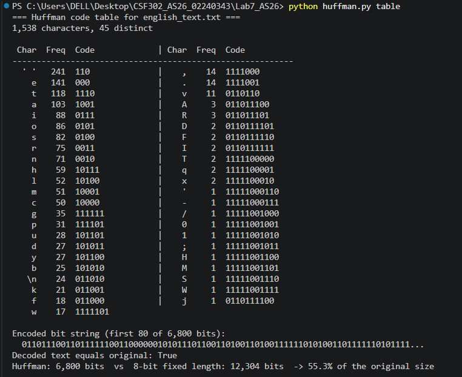

Compression ratio against 8-bit fixed-length encoding for three different files:

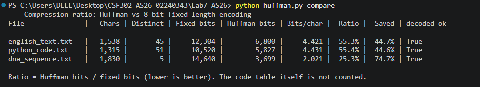

| File | Bits/char | Size vs 8-bit |
|------|-----------|---------------|
| English text | 4.42 | 55.3% |
| Python code | 4.43 | 55.4% |
| DNA sequence (4 letters) | 2.02 | 25.3% |

Fewer distinct characters with more uneven frequencies give better compression. The code table is not counted in these sizes.

## Q3: Shortest Paths and Minimum Spanning Trees

```
python graphs.py dijkstra
python graphs.py mst
python graphs.py timing
python graphs.py negative
```

Dijkstra (binary heap) from source `s` on the graph in `data/graph.txt`:

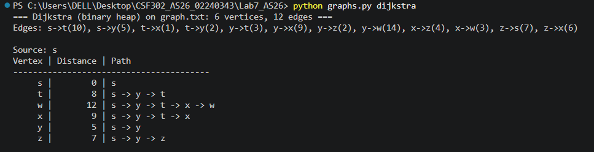

Kruskal and Prim give the same total weight on 15 random connected graphs:

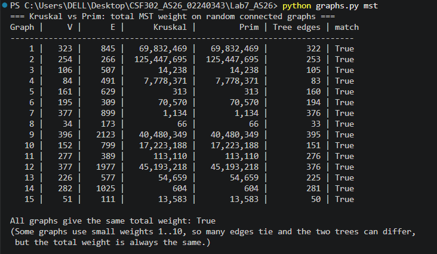

Timing with V = 1,000 on a sparse graph (E ≈ 3V) and a dense graph (E ≈ V²/4):

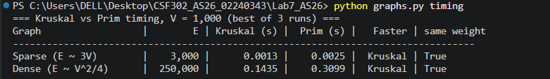

**Which wins:**
- **Sparse graph:** both take about a millisecond.
- **Dense graph:** Kruskal wins here. Its main cost is one call to Python's built-in `sorted()`, which runs in C, while Prim pushes and pops up to E heap entries in Python.
- **Theory:** both are O(E log V). A dense graph favours Prim with a plain array, which is O(V²) with no log factor. A sparse graph favours Kruskal.

One negative edge (b→a = −4) makes Dijkstra wrong. It finalises `a` before discovering the cheaper path through `b`. Bellman–Ford gives the correct distances:

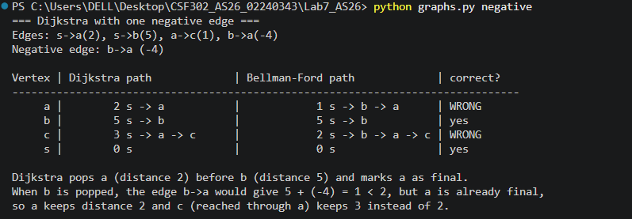

## Q4: Randomized Algorithms

```
python randomized.py quickselect
python randomized.py primes
python randomized.py carmichael
```

Randomized quickselect compared with sorting and indexing, for n = 10⁴ to 10⁶:

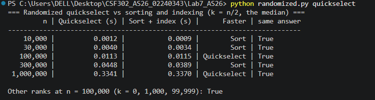

Quickselect is expected O(n) and sorting is O(n log n), but here they are very close. Python's `sorted()` runs in C, while quickselect's partitioning runs in Python, and that cancels out the log n advantage at these sizes.

Miller–Rabin (20 rounds) compared with trial division on 20 random 12-digit numbers. Every second number is moved to the next prime so that both answers appear:

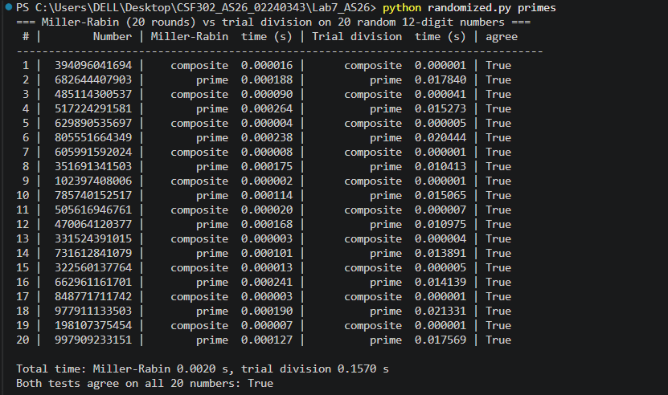

Both tests agree on all 20 numbers. On primes, Miller–Rabin is roughly 50–150× faster, because trial division has to try every odd divisor up to √n ≈ 10⁶.

Miller–Rabin with 1 round on the Carmichael number 561, run 1,000 times:

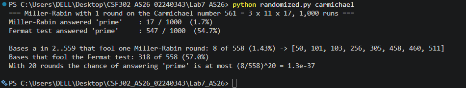

Miller–Rabin answered "prime" only about 1.7% of the time, because just 8 of the 558 possible bases fool it. The Fermat test is fooled by 57% of bases.

> Timings are from one run on my machine and will vary slightly between runs.
